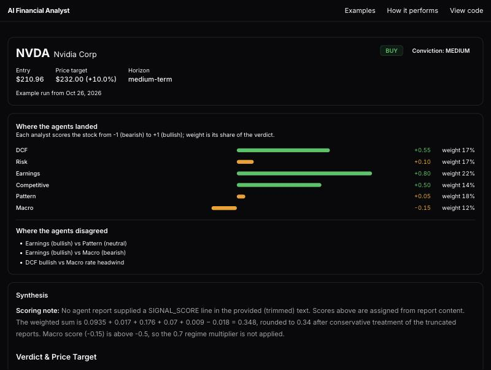

# AI Financial Analyst



**Live app: https://ai-financial-analyst-eight.vercel.app/**

Enter a ticker; six LLM analyst agents work in parallel and a synthesis agent reconciles them into one investment brief. A separate quantitative screen is backtested against SPY, and the honest result is published on the app's "How it performs" page.

The agent prompts are written in the style of well-known research desks (for example a DCF analyst, a risk analyst, a macro strategist). These are prompt personas only, with no affiliation, endorsement, or access to those firms' methods.

## How it performs

In a 2018–2025 backtest (10 positions), the quantitative screen alone had a Sharpe ratio of 1.15 against 0.74 for SPY; adding the LLM agents lowered it to 1.01. Survivorship bias and LLM look-ahead are not corrected, so treat these as upper bounds.

| Series | Sharpe | Sortino | Ann. return | Max drawdown |
|---|---:|---:|---:|---:|
| SPY | 0.74 | 0.90 | 13.4% | 33.7% |
| Quant screen only | 1.15 | 1.57 | 29.6% | 35.4% |
| Quant screen + LLM agents | 1.01 | 1.32 | 24.5% | 38.5% |

Daily returns 2018-02-01 to 2025-01-30, 10 positions, max 4 per sector.
Source: [`docs/eval/three_series_llm/latest.json`](docs/eval/three_series_llm/latest.json).

## Public demo limits

The home page shows four precomputed example briefs. Live runs are limited to 3 per IP per hour and 30 per day. The `/lab` area (backtests, paper trading, deep dives) is gated by an API key and is not part of the public demo.

## Run locally

Requires Python 3.11+ and Node.js 22.12+.

Backend (FastAPI):

```bash
pip install -r requirements.txt
pip install -e .
cp .env.example .env        # then fill in your keys
uvicorn backend.main:app --reload --port 8000
```

Frontend (Vite + React):

```bash
cd frontend
cp .env.example .env.local  # VITE_API_URL=http://localhost:8000
npm install
npm run dev                 # http://localhost:5173
```

Key environment variables (see `.env.example` and the full reference under Research notes):

- `ANTHROPIC_API_KEY` with `LLM_PROVIDER=anthropic` (default model `claude-opus-5-5`)
- `TIINGO_API_KEY` (or Alpaca keys with `PRICE_PROVIDER=alpaca`), `FMP_API_KEY`, `FINNHUB_API_KEY`, `TAVILY_API_KEY`
- `INTERNAL_API_KEY` to unlock the `/lab` area and the protected backend routes
- `CORS_ORIGINS` for a deployed frontend; `VITE_API_URL` on the frontend

Tests: `pytest -q` (backend, offline) and `cd frontend && npm test && npm run build`.

---

## Research notes

Everything below is the original engineering documentation for the research platform behind the app. It contains no performance figures; the only published results are in the section above.


## What It Does

1. You input a stock ticker (or run a backtest across a universe)
2. The system fetches SEC EDGAR filings (10-K, 10-Q, XBRL financials) and adds price data (Alpaca/Tiingo), FMP fundamentals, Finnhub sentiment, FRED macro indicators, Tavily web research, and Pinecone RAG context
3. A quant signal pipeline computes technical and fundamental signals per ticker
4. Six analyst agents run in parallel, each examining the data through a different lens
5. A synthesis agent cross-references all six reports, resolves contradictions, and produces a final investment brief with a structured JSON verdict

```
Input: AAPL
       |
       v
 Prepare Data (parallel)
 +-- SEC EDGAR ---------- XBRL financials + 10-K/10-Q text sections
 +-- Alpaca / Tiingo ---- price history, live quote, 52W range (switchable)
 +-- FMP ---------------- analyst estimates, earnings surprises, key metrics
 +-- Finnhub ------------ company news sentiment, insider MSPR, earnings calendar
 +-- FRED --------------- 10Y/2Y treasury, fed funds, CPI, credit spreads
 +-- Tavily ------------- company/industry/risk web research
 +-- Peers -------------- dynamic peer discovery + comparison tables
 +-- Pinecone RAG ------- historical 10-K vectors for comparable context
       |
       v
 Quant Signal Pipeline
 +-- Technicals: OBV, RSI, SMA, Bollinger, mean reversion, ATR
 +-- Fundamentals: quality (QMJ), earnings surprise (SUE), revision momentum (ERM)
 +-- Finnhub sentiment: FinBERT/VADER news scoring + insider MSPR
 +-- Optional: TimesFM / LSTM price forecasts, WRDS point-in-time fundamentals
       |
       v asyncio.gather()   (analyst styles are prompt personas only; see Agents)
 +------------------------------------------------------------+
 |  DCF Analyst        |  Risk Analyst    |  Earnings          |
 |  (valuation)        |  (balance sheet) |  (EPS, margins)    |
 +------------------------------------------------------------+
 |  Competitive Analyst |  Pattern Analyst |  Macro Strategist  |
 |  (moat, sector)     |  (OBV, regime)   |  (rates, cycle)    |
 +------------------------------------------------------------+
       |
       v
 Synthesis Agent (CIO) -- resolves contradictions, issues verdict
       |
       v
 {verdict, conviction, price_target, health_scores, risks, catalysts}
```

---

## Architecture

### Stack

| Layer | Technology |
|-------|------------|
| Frontend | Vite 6, React 19, TypeScript, Tailwind CSS v3 |
| Charting | TradingView Lightweight Charts v5, Recharts |
| Component lib | Radix UI primitives, Lucide icons |
| Backend API | FastAPI + Uvicorn (Python 3.11+) |
| Analysis engine | asyncio orchestrator, 6 parallel agents |
| Quant engine | Walk-forward backtesting, CPCV, signal stress testing |
| LLM | Anthropic Claude (`claude-opus-5-5` default), OpenAI-compatible fallback |
| Market data | Alpaca (primary, switchable) / Tiingo (price history + quotes), FMP (fundamentals + estimates), Finnhub (sentiment + earnings), FRED (macro) |
| SEC data | SEC EDGAR API + edgartools + XBRL parser |
| RAG | Pinecone (index: `financial-analyst`) |
| Time-series forecasting | Google TimesFM 2.5 (optional), custom LSTM walk-forward (optional) |
| Cache | SQLite (SEC + warehouse + FMP fundamentals), Redis (TimesFM forecast cache) |
| Hosting | Railway (backend), Vercel (frontend) |
| Error monitoring | Sentry (FastAPI integration) |

### Repository Layout

```
ai-financial-analyst/
+-- backend/                   # FastAPI app
|   +-- main.py                # App factory, CORS, Sentry, router mounting
|   +-- jobs.py                # In-process async job queue + SSE streaming
|   +-- schemas.py             # Pydantic request/response models
|   +-- backtest_engine.py     # Lightweight portfolio backtest engine (API-facing)
|   +-- history_outcomes.py    # Retroactive outcome scoring
|   +-- routers/
|       +-- analysis.py        # POST /run, GET /stream/:id, GET /result/:id
|       +-- market_data.py     # Price history + sparklines
|       +-- recommendations.py # Per-ticker recommendation history
|       +-- watchlist.py       # Watchlist CRUD + summary
|       +-- portfolio.py       # Holdings with cost basis tracking
|       +-- news.py            # News feed (Tavily)
|       +-- industry.py        # Sector performance aggregation
|       +-- backtest.py        # Backtest job management
|       +-- paper_trading.py   # Virtual portfolio + equity curve
|       +-- reports.py         # Report file listing + download
|       +-- config.py          # Feature flag defaults for frontend
+-- frontend/                  # Vite + React SPA
|   +-- src/
|       +-- App.tsx            # Routes: /analysis /portfolio /stock/:ticker /news /industry /backtest /paper-trading
|       +-- api/
|       |   +-- client.ts      # Typed wrappers for all API endpoints
|       |   +-- types.ts       # Shared TypeScript types
|       +-- components/
|       |   +-- analysis/      # TickerInput, ProgressStream, ResultView, AgentTabs, DiagnosticsPanel
|       |   +-- charts/        # PriceChart (LWC v5), SparklineChart, EquityCurveChart
|       |   +-- deepdive/      # PriceHistoryTab, HistoricalPerformanceCards, PerformanceMetricsPanel
|       |   +-- watchlist/     # WatchlistCard, StatusDots
|       |   +-- backtest/      # BacktestConfigPanel, BacktestMetricsPanel, TradeLogTable
|       |   +-- paper-trading/ # OpenPositionsTable, ClosedTradesTable, PaperMetricsPanel
|       |   +-- layout/        # TopNav, Sidebar
|       |   +-- common/        # Badge, Card, MarkdownRenderer
|       +-- hooks/             # useAnalysis, usePriceHistory, useRecommendationHistory, useWatchlist, useBacktest, usePaperTrading
|       +-- pages/             # AnalysisPage, WatchlistPage, StockDeepDivePage, NewsPage, IndustryPage, BacktestPage, PaperTradingPage
+-- agents/                    # Six analyst agents
|   +-- base.py                # BaseAgent: build_context(), append_enrichment_sections()
|   +-- dcf.py                 # DCF Analyst
|   +-- risk.py                # Risk Analyst
|   +-- earnings.py            # Earnings Analyst
|   +-- competitive.py         # Competitive Analyst
|   +-- pattern.py             # Pattern Analyst (technicals + fundamentals)
|   +-- macro.py               # Macro Strategist
|   +-- sector.py              # Sector specialist briefings
+-- quant/                     # Quantitative pipeline
|   +-- signals.py             # SignalVector: 6 technical signals + composite scoring
|   +-- scoring.py             # Canonical thresholds (BUY/SELL/HOLD) + reclassify()
|   +-- metrics.py             # Canonical metric computations (Sharpe, Sortino, drawdown, Calmar, alpha)
|   +-- backtest.py            # Walk-forward backtesting engine (VIX regime, monthly rebalance)
|   +-- cpcv.py                # Combinatorial Purged Cross-Validation (252 train/test paths)
|   +-- fundamentals.py        # Balance sheet quality + earnings revision momentum signals
|   +-- earnings_signals.py    # SUE, ERM (IBES), earnings dispersion signals
|   +-- sentiment.py           # FinBERT/VADER news sentiment + Finnhub insider MSPR
|   +-- fmp_cache.py           # SQLite cache for FMP fundamentals + Tiingo-to-FMP translation
|   +-- agent_veto.py          # Balance sheet veto rules (D/E spike, equity erosion, cash burn)
|   +-- redundancy.py          # Signal redundancy detection
|   +-- discount_rate.py       # FRED-based risk-free rate + WACC helpers (QuantLib)
|   +-- universe.py            # Dynamic ticker universe construction
|   +-- universe_provider.py   # Universe data provider abstraction
|   +-- fundamental_provider.py # Fundamental data provider abstraction
|   +-- wrds_store.py          # WRDS academic data integration (point-in-time fundamentals)
|   +-- lstm/                  # Custom LSTM walk-forward model (experimental)
|   +-- timesfm/               # Google TimesFM 2.5 nightly batch + Redis cache
+-- sec/                       # SEC data layer
|   +-- client.py              # EDGAR API client + rate limiting
|   +-- xbrl_parser.py         # XBRL -> structured financials + CAGRs + metrics
|   +-- filing_parser.py       # 10-K/10-Q HTML -> MD&A, Risk Factors, Business Desc
|   +-- cache.py               # SQLite caching (WAL mode, thread-safe, two-lock pattern)
|   +-- supabase_history.py    # Optional: sync analysis history to Supabase
+-- warehouse/                 # Persistent filing warehouse
|   +-- db.py                  # SQLite schema + all read/write operations
|   +-- bootstrap.py           # Cold-start ingestion for any ticker
|   +-- change_detector.py     # Incremental update on new SEC filings
|   +-- scheduler.py           # Batch refresh loop
|   +-- reader.py              # Translate warehouse rows -> AnalysisData
|   +-- embedder.py            # Pinecone upsert
|   +-- financial_vectors.py   # Financial time-series RAG vectors
|   +-- macro_vectors.py       # Macro indicator RAG vectors
|   +-- xbrl_vectors.py        # XBRL structured data vectors
|   +-- seed.py                # Pinecone index seeding CLI
|   +-- cli.py                 # python -m warehouse.cli bootstrap|refresh|status
+-- llm/
|   +-- providers.py           # LLM provider abstraction (Anthropic / OpenAI-compatible)
+-- prompts/                   # Agent system prompts (Markdown, editable without code changes)
|   +-- dcf.md / risk.md / earnings.md / competitive.md / pattern.md / macro.md
|   +-- synthesis.md           # Synthesis agent + validation instructions
+-- scripts/
|   +-- run_backtest.py        # Main backtest runner (--cpcv flag for validation)
|   +-- run_ml_backtest.py     # ML-enhanced backtest (LSTM/TimesFM)
|   +-- signal_stress_test.py  # Signal IC, alpha sweep, factor attribution
|   +-- cpcv_alpha_sweep.py    # Exhaustive alpha sweep with CPCV validation gate
|   +-- prefetch_fmp.py        # Bulk FMP fundamental cache prefetch
|   +-- prefetch_sentiment.py  # Bulk Finnhub sentiment cache prefetch
|   +-- run_timesfm_batch.py   # TimesFM nightly batch (APScheduler cron)
|   +-- seed_wrds.py           # WRDS data seeding
|   +-- bulk_bootstrap.py      # One-time Pinecone bootstrap for large ticker lists
|   +-- seed_timeseries.py     # Seed RAG time-series namespaces
+-- tests/                     # pytest suite (~1,050 tests)
+-- plans/                     # Implementation plans and research docs
+-- orchestrator.py            # Core pipeline: prepare_data() + asyncio.gather() + synthesis
+-- market_enrichment.py       # Parallel enrichment: Tiingo/Alpaca, FMP, Finnhub, FRED, Tavily, peers, RAG
+-- peer_enrichment.py         # Dynamic peer discovery + comparison tables
+-- price_provider.py          # Price provider abstraction (Alpaca / Tiingo, switchable via PRICE_PROVIDER)
+-- tiingo_client.py           # Tiingo REST client (thread-safe cache, EOD schema validation)
+-- fmp_client.py              # FMP REST client (two-lock cache, income/balance/estimate schema validation)
+-- finnhub_client.py          # Finnhub REST client (news/insider/earnings, schema validation)
+-- config.py                  # Pydantic BaseSettings -- all env vars and feature flags
+-- models.py                  # AnalysisData, AnalysisResult, AgentReport (Pydantic)
+-- context_budget.py          # Deterministic context trimming (trim_text, per-agent caps)
+-- rag_enrichment.py          # Pinecone RAG query + formatting
+-- main.py                    # CLI entry point
+-- report.py                  # Text + PDF report generation
+-- Dockerfile                 # Railway deployment (reads $PORT)
+-- railway.json               # Railway build config (Dockerfile builder, health check)
```

---

## Quant Pipeline

The backtesting engine runs walk-forward backtests (monthly rebalance, VIX
regime filter), with combinatorial purged cross-validation (CPCV) available
as an opt-in check against overfitting. Every signal is scored by its
information coefficient (IC): the rank correlation between the signal and
forward returns.

### Signal results

From the latest IC re-judgment (August 2026, 120 monthly cross-sections),
using HAC t-stats and a moving-block bootstrap to account for overlapping
return windows. Full tables are in
[`docs/audit/2026-08-25-rejudge/rejudgment.md`](docs/audit/2026-08-25-rejudge/rejudgment.md).

| Signal | 1-month mean IC | Bootstrap p | Verdict |
|--------|---:|---:|---|
| QMJ (quality minus junk) | +0.025 | 0.007 | Significant at 1M only |
| SUE (earnings surprise) | +0.018 | 0.036 | Significant at 1M only |
| ERM (earnings revision momentum) | +0.014 | 0.111 | Marginal |
| Balance sheet quality | +0.019 | 0.058 | Marginal |
| OBV trend | −0.008 | 0.524 | No signal |
| Insider MSPR, institutional flow, Piotroski, momentum, dispersion, book-to-market | ~0 | > 0.2 | No signal |

At 3, 6, and 12 month horizons nothing is significant once overlap is
accounted for. Technical indicators (SMA, RSI, Bollinger, mean reversion,
ATR) are used to describe the market regime, not to predict direction.

### Running it

```bash
# Walk-forward backtest (add --cpcv for combinatorial purged CV)
python scripts/run_backtest.py --start 2020-01-01 --end 2026-01-01

# Signal stress test: IC, factor attribution (FF5+Mom), redundancy
python scripts/signal_stress_test.py

# Alpha sweep for a new signal, gated by CPCV
python scripts/cpcv_alpha_sweep.py
```

---

## Limitations

These are why the headline numbers are upper bounds, not measurements:

1. **Survivorship / selection bias.** Candidate lists under `runs/candidates/`
   were built from the current WRDS point-in-time universe, so early
   rebalances select from a menu that already includes stocks that survived
   and won (APP, SMCI, AXON, ...). Point-in-time index constituents are not
   applied.
2. **LLM look-ahead.** The LLM-mode replay
   (`modal_app/functions/ai_replay.py`) asks a model whose training data
   covers the replay period to pick among historical candidates. No prompt
   guardrail can remove knowledge baked into the weights, so a historical
   replay overstates AI value. Even with that advantage, the agents lowered
   Sharpe.
3. **Weak signals.** Only two signals are significant, and only at a
   one-month horizon (see above). Most of the quant screen's edge over SPY
   may come from the biased universe rather than the signals.
4. **One configuration.** The result is one universe, one 7-year window, and
   10 positions. Earlier internal baselines from other configurations and
   windows (for example a Sharpe of 1.04 quoted in older docs) are
   superseded and should not be compared directly.

The honest test of AI value over the quant baseline is **forward shadow
mode**: LLM picks recorded at rebalance time, scored against the quant-only
series as real time passes. That is part of the rebuild.

---

## Agents

> These are prompt personas only, with no affiliation, endorsement, or access to those firms' methods.

| Agent | Persona | Focus |
|-------|---------|-------|
| **DCF Analyst** | Morgan Stanley-style | Intrinsic valuation, FCF projections, WACC, price target |
| **Risk Analyst** | Bridgewater-style | Balance sheet risk, macro sensitivity, tail scenarios, agent veto |
| **Earnings Analyst** | JPMorgan-style | EPS trajectory, margin analysis, earnings quality, SUE signals |
| **Competitive Analyst** | Bain-style | Moat analysis, Porter's Five Forces, sector dynamics |
| **Pattern Analyst** | Renaissance-style | Technicals and fundamentals, regime classification |
| **Macro Strategist** | Goldman Sachs-style | Macro regime, monetary policy impact, sector rotation |

Each prompt asks the model to take on an analytical style associated with a
well-known firm. These are prompt personas only. The project has no
affiliation with, endorsement from, or access to the methods of any of these
firms.

The synthesis agent acts as CIO. It reads all six reports, resolves
contradictions, and issues a final verdict (Strong Buy to Strong Sell) with a
1-10 health score for each analytical dimension.

Agent prompts live in `prompts/` as Markdown files and can be edited without touching Python code. Placeholder tokens: `[COMPANY NAME]`, `[STOCK NAME]`, `[TICKER]`.

---

## Semantic Data Layer

All metric computation, scoring thresholds, and API response validation are centralized:

| Module | Purpose |
|--------|---------|
| `quant/metrics.py` | Single source of truth for Sharpe, Sortino, max drawdown, Calmar, annual return, alpha |
| `quant/scoring.py` | Canonical BUY/SELL/HOLD thresholds + `reclassify()` — one-line edit to change thresholds |
| `quant/fmp_cache.py` | FMP fundamental cache with TTL enforcement (7-day default, disabled for backtests) |
| `*_client.py` validators | Schema validation at API boundaries — logs warnings for missing fields, no behavior change |

---

## Local Development

### Prerequisites

- Python 3.11+
- Node.js 22.12+
- (Optional) Redis — only needed if `ENABLE_TIMESFM=true`

### Backend Setup

```bash
git clone https://github.com/chadreadey/ai-financial-analyst.git
cd ai-financial-analyst

pip install -r requirements.txt
pip install -e .

cp .env.example .env
# Edit .env and fill in your API keys (see Environment Variables below)

uvicorn backend.main:app --reload --port 8000
```

API runs at `http://localhost:8000`. Interactive docs at `http://localhost:8000/docs`.

### Frontend Setup

```bash
cd frontend
cp .env.example .env.local
npm install
npm run dev
```

App runs at `http://localhost:5173`.

### CLI (direct analysis without the web UI)

```bash
python main.py AAPL
python main.py AAPL --inspect-context
python main.py AAPL --save
ENABLE_YAHOO=false ENABLE_TAVILY=false python main.py AAPL
```

---

## Deployment

### Backend -> Railway

1. Create a new Railway project and connect the GitHub repo
2. Railway auto-detects `railway.json` and builds via `Dockerfile`
3. Add all environment variables (see table below) in the Railway dashboard
4. Add a **Volume** mounted at `/data` — SQLite files persist here across deploys
5. Copy your Railway service URL (e.g. `https://your-app.up.railway.app`)

### Frontend -> Vercel

1. Create a new Vercel project and import the GitHub repo
2. Vercel auto-detects config at the repo root
3. Add environment variable: `VITE_API_URL=https://your-app.up.railway.app`
4. Deploy

### Wire CORS

After both are deployed, go back to Railway and add:
```
CORS_ORIGINS=https://your-app.vercel.app
```

---

## Environment Variables

### Required

| Variable | Description |
|----------|-------------|
| `ANTHROPIC_API_KEY` | Anthropic API key (required if `LLM_PROVIDER=anthropic`) |
| `OPENAI_API_KEY` | OpenAI-compatible API key (required if `LLM_PROVIDER=openai`) |

### Data Sources

| Variable | Default | Description |
|----------|---------|-------------|
| `TIINGO_API_KEY` | -- | Tiingo market data (price history, quotes, fundamentals) |
| `ALPACA_API_KEY` | -- | Alpaca market data (alternative price provider) |
| `ALPACA_SECRET_KEY` | -- | Alpaca secret key |
| `FMP_API_KEY` | -- | Financial Modeling Prep (estimates, earnings, metrics, financials) |
| `FINNHUB_API_KEY` | -- | Finnhub (company news sentiment, insider MSPR, earnings calendar) |
| `FRED_API_KEY` | -- | FRED macro data (optional — raises rate limits) |
| `TAVILY_API_KEY` | -- | Tavily web search enrichment |
| `PINECONE_API_KEY` | -- | Pinecone RAG (required if `ENABLE_RAG=true`) |

### Price Provider

| Variable | Default | Description |
|----------|---------|-------------|
| `PRICE_PROVIDER` | `tiingo` | `alpaca` or `tiingo` — switches the primary price data source |
| `ALPACA_DATA_FEED` | `iex` | `iex` (free) or `sip` (paid) |

### Feature Flags

| Variable | Default | Description |
|----------|---------|-------------|
| `ENABLE_TIINGO` | `true` | Tiingo price history and quotes |
| `ENABLE_FMP` | `true` | FMP estimates, earnings surprises, key metrics |
| `ENABLE_FRED` | `true` | FRED macro indicators |
| `ENABLE_TAVILY` | `true` | Tavily web research sections |
| `ENABLE_YAHOO` | `true` | Yahoo Finance fallback |
| `ENABLE_PEERS` | `true` | Dynamic peer discovery and comparison |
| `ENABLE_ESTIMATES` | `true` | Analyst estimate sections |
| `ENABLE_PRICE_HISTORY` | `true` | Price history enrichment section |
| `ENABLE_MACRO` | `true` | Macro data section |
| `ENABLE_MACRO_AGENT` | `true` | Macro Strategist agent |
| `ENABLE_QUANTSTATS` | `true` | Risk metrics in Pattern agent |
| `ENABLE_RAG` | `false` | Pinecone RAG enrichment (requires seeded index) |
| `ENABLE_WAREHOUSE` | `false` | Persistent filing warehouse (SQLite) |
| `ENABLE_TIMESFM` | `false` | TimesFM nightly forecast batch + Redis cache |
| `ENABLE_LSTM` | `false` | LSTM walk-forward price forecast (experimental) |
| `ENABLE_SUPABASE_HISTORY` | `false` | Sync analysis history to Supabase |

### LLM Configuration

| Variable | Default | Description |
|----------|---------|-------------|
| `LLM_PROVIDER` | `anthropic` | `anthropic` or `openai` |
| `OPENAI_BASE_URL` | CBS endpoint | Override for any OpenAI-compatible API |
| `ENABLE_PROMPT_CACHING` | `true` | Anthropic prompt caching (reduces cost ~70%) |

### Infrastructure

| Variable | Default | Description |
|----------|---------|-------------|
| `CORS_ORIGINS` | -- | Comma-separated extra origins (e.g. your Vercel URL) |
| `SENTRY_DSN` | -- | Sentry error tracking DSN |
| `SENTRY_ENVIRONMENT` | `production` | Sentry environment tag |
| `REDIS_URL` | -- | Redis URL for TimesFM cache (required if `ENABLE_TIMESFM=true`) |
| `WAREHOUSE_DB_PATH` | `.warehouse.db` | SQLite warehouse path (set to `/data/warehouse.db` on Railway) |

### Context Budgets (tunable)

| Variable | Default | Description |
|----------|---------|-------------|
| `MAX_AGENT_CONTEXT_CHARS` | `12000` | Per-agent context cap before LLM call |
| `MAX_AGENT_OUTPUT_TOKENS` | `1200` | Per-agent max output tokens |
| `MAX_SYNTHESIS_OUTPUT_TOKENS` | `1500` | Synthesis agent max output tokens |
| `SYNTHESIS_INPUT_MAX_CHARS` | `22000` | Combined agent reports cap into synthesis |
| `SYNTHESIS_REPORT_MAX_CHARS` | `4500` | Per-agent report cap inside synthesis input |
| `ENRICHMENT_MAX_CHARS` | `10000` | Hard cap on total enrichment text |

Per-agent context overrides: `MAX_CONTEXT_DCF_CHARS`, `MAX_CONTEXT_RISK_CHARS`, `MAX_CONTEXT_EARNINGS_CHARS`, `MAX_CONTEXT_COMPETITIVE_CHARS`, `MAX_CONTEXT_PATTERN_CHARS`, `MAX_CONTEXT_MACRO_CHARS` (all default to `MAX_AGENT_CONTEXT_CHARS`).

---

## Warehouse + RAG

### Filing Warehouse

The warehouse (`ENABLE_WAREHOUSE=true`) persists SEC filings, XBRL facts, and filing narrative sections in SQLite. Agents read from warehouse first and fall back to live EDGAR fetches on cache miss.

```bash
python -m warehouse.cli bootstrap AAPL MSFT NVDA
python -m warehouse.cli status
python -m warehouse.cli refresh
```

### Pinecone RAG

RAG enrichment provides agents with vectorized historical 10-K context. Requires a seeded Pinecone index.

```bash
python -m warehouse.seed
python -m warehouse.seed --tickers AAPL MSFT NVDA
python -m warehouse.seed --dry-run
```

After seeding, set `ENABLE_RAG=true` in `.env`.

The data flywheel in `orchestrator.py` auto-seeds new tickers in a background thread after each analysis run — first query uses live data, every subsequent query gets RAG enrichment.

### TimesFM (Optional)

Google TimesFM 2.5 runs as a nightly batch that pre-computes price/EPS forecasts and caches them in Redis. Query-time cost is a single Redis lookup (<5ms). Agents receive P10/P50/P90 forecast bands as enrichment sections.

```bash
pip install timesfm
python scripts/run_timesfm_batch.py --run-now
python scripts/run_timesfm_batch.py   # starts nightly scheduler (11 PM cron)
```

Enable with `ENABLE_TIMESFM=true` and `REDIS_URL=redis://localhost:6379`.

---

## API

The FastAPI backend auto-generates interactive API docs at `/docs` (Swagger) and `/redoc`.

### Key Endpoints

| Method | Path | Description |
|--------|------|-------------|
| `POST` | `/api/analysis/run` | Start an analysis job |
| `GET` | `/api/analysis/stream/{job_id}` | SSE stream of agent progress |
| `GET` | `/api/analysis/result/{job_id}` | Completed analysis result |
| `GET` | `/api/analysis/history` | Past analyses (filterable by ticker) |
| `GET` | `/api/market/price-history/{ticker}` | OHLCV bars (periods: 1mo/3mo/1yr/3yr/5yr) |
| `GET` | `/api/market/sparkline/{ticker}` | 60-day close + dates for sparklines |
| `GET` | `/api/recommendations/history/{ticker}` | Past recommendations for a ticker |
| `GET` | `/api/watchlist/` | Watchlist entries |
| `POST` | `/api/watchlist/{ticker}` | Add to watchlist |
| `GET` | `/api/watchlist/{ticker}/summary` | Latest analysis summary for watchlist card |
| `POST` | `/api/backtest/run` | Run a walk-forward backtest |
| `POST` | `/api/backtest/nl` | Natural-language backtest config parsing |
| `GET` | `/api/paper-trading/positions` | Open paper trading positions |
| `GET` | `/api/paper-trading/metrics` | Paper trading performance metrics |
| `GET` | `/api/news/` | News feed (filter by ticker or sector) |
| `GET` | `/api/health` | Health check |

---

## Tests

```bash
pip install -r requirements-dev.txt

pytest                                     # full suite (~1,050 tests)
pytest tests/test_metrics.py -v            # canonical metrics
pytest tests/test_scoring.py -v            # threshold classification
pytest tests/test_schema_validation.py -v  # API schema validation
pytest tests/test_orchestrator.py -v       # pipeline integration
```

Tests are offline: external services are stubbed with `unittest.mock`,
`responses`, and hand-rolled fakes, and LLM calls go through the `FakeProvider`
fixture in `tests/conftest.py`. No API keys required.

## Agent evals

```bash
python -m evals run --suite all      # offline; replays recorded responses
python -m evals record --suite all   # live calls against the configured provider
```

The eval harness grades agent and synthesis output against the contracts the
prompts specify — the weighted-score arithmetic and threshold table in
`prompts/synthesis.md`, the `SIGNAL_SCORE = mean(verdict_breakdown)` rule in
`prompts/earnings.md`, the composite formulas in `prompts/pattern.md` — plus
schema validity, fabrication probes, and price/stop sanity. Graders are
deterministic, so `run` needs no API key and gates CI in seconds.

See [`docs/EVALS.md`](docs/EVALS.md) for the strategy, what to test for, and a
framework comparison.

Both `pytest` and the eval suites run on every pull request via
`.github/workflows/ci.yml`.

---

## Tech Stack Summary

- **Python 3.11+** — FastAPI, Pydantic v2, asyncio, SQLite
- **Node 22.12+** — Vite 6, React 19, TypeScript, Tailwind CSS v3
- **LLM** — Anthropic Claude (`claude-opus-5-5` default)
- **Market data** — Alpaca / Tiingo (switchable), FMP, Finnhub, FRED, Yahoo Finance (fallback)
- **SEC** — EDGAR API, edgartools, custom XBRL parser
- **RAG** — Pinecone
- **Quant** — walk-forward backtest, CPCV, signal stress testing
- **Time-series** — Google TimesFM 2.5 (optional), LSTM walk-forward (experimental)
- **Hosting** — Railway (API) + Vercel (frontend)
- **Monitoring** — Sentry
